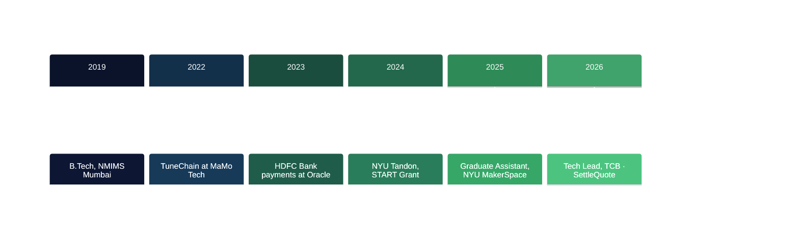

---

## 🎯 Summary

**Payment systems · Product management · Blockchain**

*I take the rules money has to follow and turn them into products that ship.*

I've built payment APIs for HDFC Bank at Oracle, moved five legacy systems into one as a graduate assistant at NYU's MakerSpace, and led a three-person team that shipped money and crypto transfers inside Telegram. Now I'm building **SettleQuote**, an API that tells AI agents which US payment rail can still meet a deadline, and finishing an **M.S. in Business Analytics** at Mercy University (Feb 2027).

**Looking for:** Product Manager, Product Analyst and Forward Deployed Engineer roles in New York, starting March 2027.

### 📊 Impact at a glance

| **Area** | **What I did** | **Result** |
|:---------|:---------------|:-----------|
| **Bank payments** | Built NEFT transfer and salary-disbursement APIs for HDFC Bank | Shipped through the final phase of HDFC's $40B merger |
| **Regulation** | Turned changing RBI mandates into build-ready specs | Validation logic for compliance in the NEFT APIs |
| **Systems migration** | Moved 5 legacy tools into one platform | 450+ member and 1,200+ asset records cleaned and reconciled |
| **Operations** | Barcoded the full inventory | 7,000+ items and 40+ machines tracked |
| **Billing** | Automated billing, late fees and deposits | Stripe and QuickBooks, reconciled automatically |
| **Team leadership** | Led a team of 3 as tech lead | Money and crypto transfers in Telegram, settled on-chain |
| **Query performance** | Range-partitioned an AML database | Alert-view rebuild cut from 4.3 s to 109 ms |
| **Agent payments** | Built a paid API for AI agents | $0.005 USDC per call over x402 |

---

## 🚀 Experience

### The Central Bulletin · Tech Lead
**Feb 2026 – May 2026 · Remote**

- Owned product architecture and engineering delivery for the client-services arm, turning client requirements into build plans
- Led a team of three that shipped an **AI-driven Telegram product** for in-chat money and cryptocurrency transfers with **on-chain settlement**
- Led delivery of a second client platform across JavaScript, Python, Polygon and Ethereum

**Stack:** JavaScript, Python, Polygon, Ethereum

---

### NYU MakerSpace · Graduate Assistant
**Jan 2025 – Jan 2026 · Brooklyn**

- Moved **5 legacy systems** (spreadsheets, Google Forms, a billing tool, a waiver PDF archive and an inventory sheet) into **WebCheckout**
- Cleaned and deduplicated **450+ member** and **1,200+ asset** records and validated every import with reconciliation scripts
- Designed the data model for assets, kits, consumables, members, memberships, reservations and checkouts, and barcoded **7,000+ items** across **40+ machines**
- Automated recurring billing, late fees, deposits and invoice reconciliation through **Stripe** and **QuickBooks**
- Tied door access and machine activation to an active membership and completed safety certifications
- Built webhook integrations with the website, email platform and Slack for onboarding, renewal and overdue notices, plus SSO and role-based permissions
- Built dashboards for utilization, revenue per machine-hour and inventory turnover, and trained **20+ staff**

**Stack:** WebCheckout, Stripe, QuickBooks, REST APIs, webhooks, SSO, Slack

---

### Oracle Financial Services Software · Associate Consultant
**Jun 2023 – Aug 2024 · Pune**

- Worked with HDFC Bank stakeholders to turn changing **RBI mandates** into build-ready requirements and product specs
- Owned backend delivery for two payment products: **salary disbursement** and **NEFT transfer APIs**
- Shipped database and API changes through the final integration phase of HDFC Bank's **$40B merger**
- Added validation logic to the NEFT APIs for RBI compliance and data integrity
- Refactored legacy Java transaction processing with multithreading to speed up batch runs

**Stack:** Java, SQL, REST APIs

---

### MaMo Tech · Blockchain Developer
**Jun 2022 – Sep 2022 · Remote**

- Built **TuneChain**, a decentralized music product that minted each track as an **ERC-1155** token on IPFS
- Wrote the Solidity contracts and a React/Web3.js front end with live on-chain play counts, plus Hardhat tests and CI deployment to Polygon testnet

**Stack:** Solidity, Hardhat, IPFS, React, Web3.js, Polygon

---

## 📈 Timeline

---

## 🛠️ Tech stack

<table>
  <tr>
    <td><b>Languages</b></td>
    <td>        </td>
  </tr>
  <tr>
    <td><b>Backend & APIs</b></td>
    <td>       </td>
  </tr>
  <tr>
    <td><b>Frontend</b></td>
    <td> </td>
  </tr>
  <tr>
    <td><b>Data & analytics</b></td>
    <td>        </td>
  </tr>
  <tr>
    <td><b>Payments</b></td>
    <td>    </td>
  </tr>
  <tr>
    <td><b>Web3</b></td>
    <td>    </td>
  </tr>
  <tr>
    <td><b>Cloud & DevOps</b></td>
    <td>       </td>
  </tr>
  <tr>
    <td><b>Integrations</b></td>
    <td>   </td>
  </tr>
</table>

**Certifications:** Oracle Cloud Infrastructure (3×, 2024) · Harvard Blockchain Essentials (2023)

---

## 🎓 Featured projects

### 1. SettleQuote
**Payment-rail API for AI agents · FastAPI · MCP · x402**

Give it an amount, a deadline and a receiver, and it tells you which US rails can still get the money there and which one costs least. AI agents call it over HTTP or MCP and pay **$0.005 in USDC** per answer through x402 (Base Sepolia testnet).

One real run: **Friday 4:50 p.m., $12,000 has to reach a US bank account by 7:00 p.m.**

| Rail | Funds land | By 7:00 p.m.? | Fed fee |
|:-----|:-----------|:--------------|--------:|
| ACH | Mon 9:00 a.m. | ❌ misses | $0.0035 |
| Same-day ACH | Mon 1:30 p.m. | ❌ misses | $0.0045 |
| **Fedwire** | **Fri 4:50 p.m.** | **✅ makes it (the pick)** | **$0.97** |
| FedNow | Fri 4:50 p.m. | ⚠️ only if both banks are on it | $0.045 |
| RTP | Fri 4:50 p.m. | ⚠️ only if both banks are on it | not published |

---

### 2. Bitcoin AML Monitoring Database
**PostgreSQL · Python ETL · Elliptic dataset**

- Loaded **203,769 Bitcoin transactions** and their payment graph into PostgreSQL
- Wrote money-laundering typologies as SQL views that feed an investigator alert queue
- Range partitioning across 49 periods cut the alert-view rebuild from **4.3 s to 109 ms**
- Added incremental refresh, role-based access control and an alert-triage case study

---

### 3. Gemini vs ChatGPT on Google Play
**Python · PostgreSQL · R**

- Collected **20,000** US Play Store reviews with a resumable Python scraper, loaded them into PostgreSQL, and analyzed them in R
- **21.0%** of Gemini reviews were 1–2 stars, against **8.6%** for ChatGPT
- Gemini's team replied to **409** reviews; ChatGPT's replied to **1**

---

