  

That quote is a real run of **[SettleQuote](https://github.com/alpeshranjan/settlequote)**, my API that tells AI agents which US payment rail can still hit a deadline, and which one costs least. Agents pay $0.005 USDC per answer over x402.

Before that I built NEFT and salary-disbursement APIs for HDFC Bank at **Oracle**, moved five legacy systems into one platform at **NYU MakerSpace**, and led a team of three shipping in-chat money transfers on Telegram at **Stroffe**.

  <a href="https://linkedin.com/in/alpeshranjan">LinkedIn</a> ·
  <a href="mailto:alpeshranjan@gmail.com">alpeshranjan@gmail.com</a> ·
  <a href="https://settlequote.fly.dev">Try the API</a>

